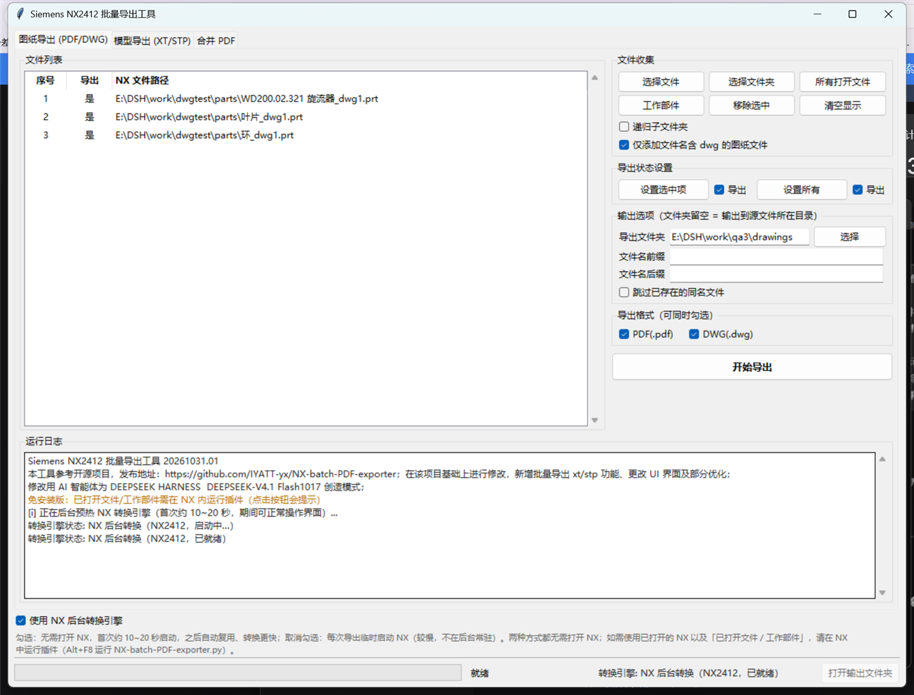
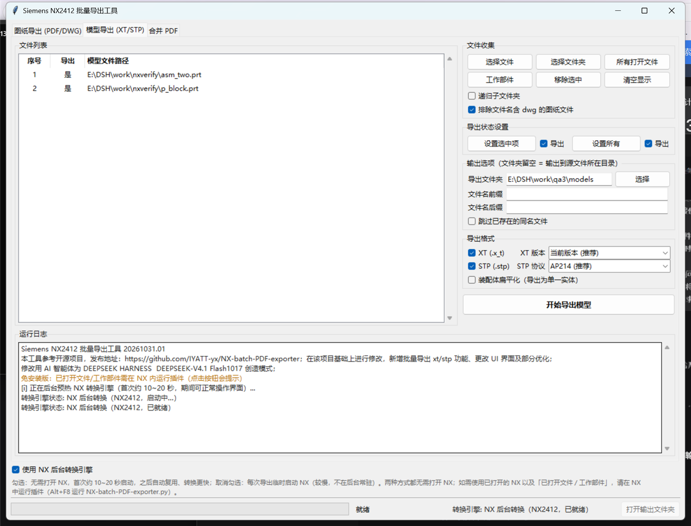
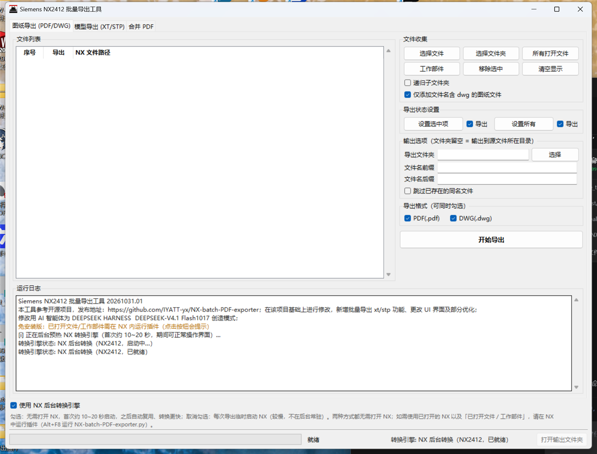
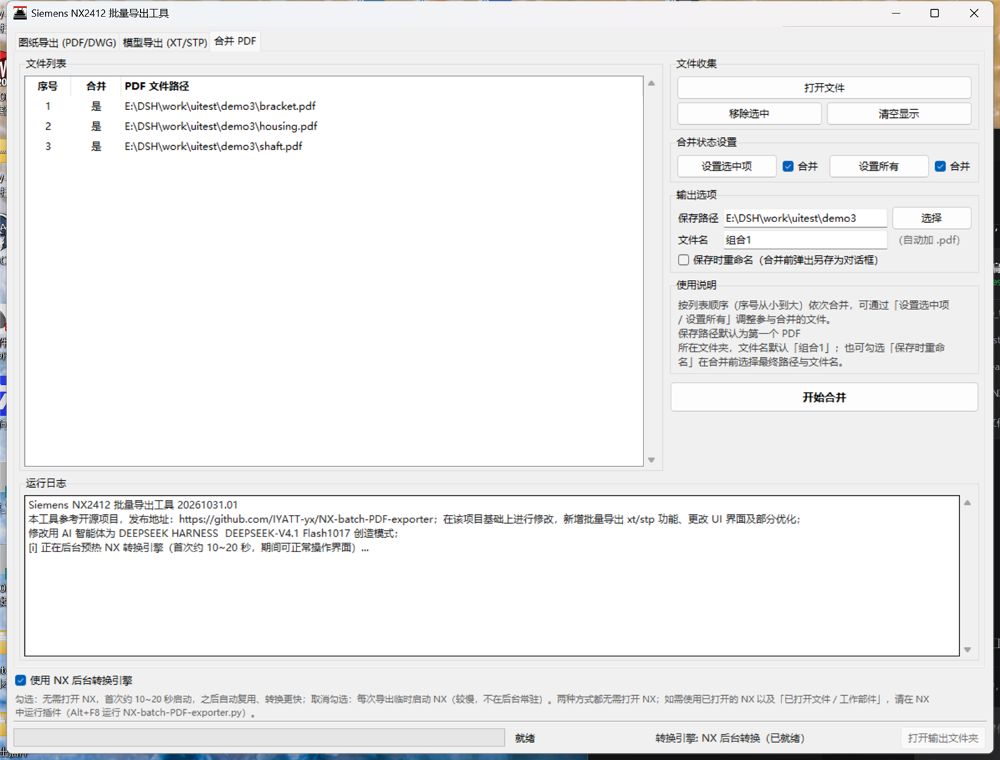
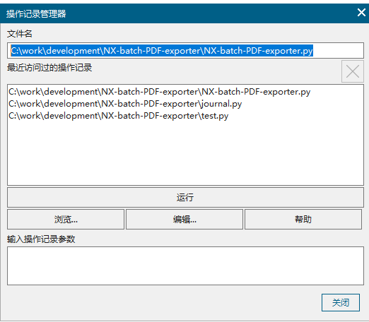
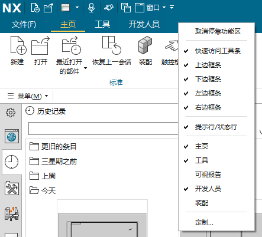
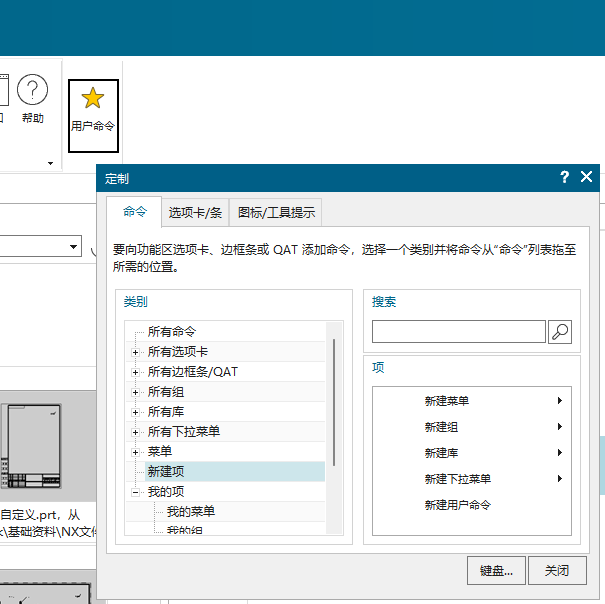
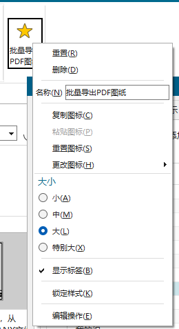
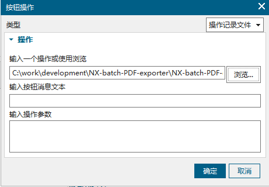
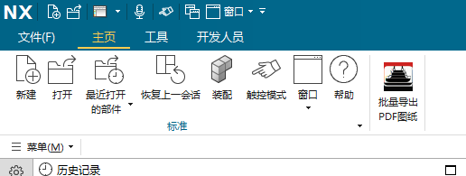

# NX-batch-PDF-exporter【Siemens NX2412 批量导出工具】

> **GitHub 仓库**：<https://github.com/hf1h9bgt/NX2412-batch-exporter>（改进版）
> **便携版下载**：请到本仓库 [Releases](../../releases) 下载 `NX2412批量导出插件_便携版_v20261031.01_win64.zip`（解压即用，内置 Python）
> **新手请先阅读**：[使用说明.md](使用说明.md)

> 本工具参考开源项目 [NX-batch-PDF-exporter](https://github.com/IYATT-yx/NX-batch-PDF-exporter)，在该项目基础上进行修改：新增批量导出 XT/STP 功能、更改 UI 界面及部分优化。  
> 修改用 AI 智能体为 DEEPSEEK HARNESS  DEEPSEEK-V4.1 Flash1017 创造模式。

  
  


---

## 更新记录

### 2026/10/31 —— 第二轮优化

1. **修复 DWG 批量导出「长时间不结束」与多余文件问题**：NX 2412 主模型出图时零件内常带一个没有视图的默认图纸页（如 `Sheet 1`），旧逻辑会把它也导出成多余 DWG，并因为等待错误的文件名而长时间卡住。现在会自动跳过无视图的空白图纸页，只导出有内容的图纸页；多图纸时按 NX 规则生成 `<文件名>_<图纸名>.dwg`，并清理转换器产生的 `.log` 文件。
2. **图纸导出支持 PDF + DWG 同时导出**：两个格式可同时勾选，一次打开部件顺序完成两种格式导出，不用等 PDF 完成后再手动导 DWG。
3. **按文件名自动区分图纸/模型文件**：图纸导出页默认只添加文件名含 `dwg` 的图纸文件；模型导出页默认排除文件名含 `dwg` 的文件。两个过滤项都是复选，可随时关闭。
4. **界面优化**：右侧控制区支持上下滚动；初始窗口加大到 1180×820（并适配 Windows 高 DPI 缩放）；底部状态栏显示「转换引擎」与进度；三个页签日志独立。
5. **新增免安装版「批量导出插件.exe」**：不用先打开 NX，也不用在 NX 里添加命令按钮；导出时自动调用本机 NX 2412 后台转换进程完成工作。
6. **更新程序名与启动横幅**，补充开源参考与 AI 修改说明。

### 2026/10/31 —— 第三轮优化（免安装版加速）

7. **免安装版新增「使用 NX 后台转换引擎」勾选项（默认勾选）**：程序启动时在后台**预热 NX 转换引擎**（首次约 10~20 秒，期间界面可正常操作），之后每次导出都复用同一个后台 NX 进程，**省去每次导出重复等待的 10~20 秒启动时间**；空闲约 30 分钟后后台 NX 自动退出释放内存，下次导出自动重启。取消勾选则每次导出临时启动 NX 后台进程（较慢、不常驻）。两种方式都**不需要预先打开 NX**。
8. **免安装版「所有打开文件 / 工作部件」按钮恢复为可点击**：受 NX 接口限制，外部程序无法接管另一个已打开的 NX 图形会话，因此点击时会弹窗提示改用 NX 内插件（按 `Alt+F8` 运行 `NX-batch-PDF-exporter.py`）获得该功能；NX 内插件中该功能保持完整可用。
9. 免安装版关闭窗口时会自动释放后台 NX 进程，不留残留进程。

### 2026/10/31 —— 第四轮优化（合并 PDF）

10. **「合并 PDF」功能优化**：
    * 合并后的 PDF **默认保存到被合并 PDF 所在路径**（第一个 PDF 的文件夹），文件名默认 **「组合1」**（自动补 `.pdf`，可修改）；
    * 新增 **「保存路径」** 选项：可直接输入或点「选择」指定合并后的保存文件夹；
    * 新增 **「保存时重命名」** 选项：勾选后点「开始合并」会先弹出另存为对话框，可修改最终路径与文件名，取消则放弃本次合并；
    * 不勾选重命名时，若目标文件已存在会提示是否覆盖。

### 2026/10/31 —— 第五轮优化（GitHub Releases 便携式压缩包）

12. **免安装版改为 Releases 风格便携式压缩包**：压缩包解压后是一个「批量导出插件」文件夹，程序按 GitHub 仓库结构**逐个文件拆开**（`standalone.py`、`application.py`、`nxmodules.py`、`modelmodules.py`、`remote_*.py` 等源码，以及 `tcl/`、`lib/pypdf`、`locales/`、`doc/` 资源），并内置 `python/` 运行时（Python 3.13 + tkinter）；**免安装、免 Python**，解压即可用。
13. **启动方式**：双击文件夹中的 `批量导出插件.exe`（70KB 启动器，带图标，作用等同快捷方式，解压到任意路径都有效）；也可用 `启动批量导出插件.vbs` / `启动批量导出插件.bat`。由于 Windows `.lnk` 保存的是绝对路径（压缩包内预置会失效），如需真正的快捷方式，双击 `创建快捷方式.cmd` 一次即可在当前文件夹生成 `批量导出插件.lnk`。
14. 构建方式：`python build_portable.py` 一键生成便携包文件夹、zip 与 `SHA256SUMS.txt`（详见下文「打包便携版」）。

### 历史版本

* 2025/11/30：批量导出图纸 PDF 的基础功能。
* 2026/3/6：新增 PDF 合并功能。
* 2026/3/7：新增 AutoCAD DWG 图纸导出格式。
* 2026/7/6：新增 XT / STP 模型导出，界面改版为三个页签（第一轮修改）。
* 2026/10/31：第二轮优化（DWG 空白页/双格式/文件名过滤/滚动界面/免安装版）；第三轮优化（常驻暖机加速、已打开文件按钮提示）；第四轮优化（合并 PDF 默认路径/组合1/保存路径/保存时重命名）；第五轮优化（GitHub Releases 便携式压缩包，解压即用、内置 Python）。

## 功能说明

工具分为三个页签：

### 一、图纸导出（PDF / DWG）

* **文件收集**：①选择文件（可多选）；②选择文件夹（可勾选「递归子文件夹」）；③所有打开文件（NX 内直接运行时可用）；④工作部件（NX 内直接运行时可用）；⑤移除选中 / 清空显示。列表会自动去重、排序，并忽略不存在的文件。
* **图纸/模型过滤**：默认勾选「仅添加文件名含 dwg 的图纸文件」。NX 2412 主模型出图时，同一零件会生成模型文件与图纸文件，图纸文件名中带 `dwg`（如 `零件_dwg1.prt`），勾选后上述四个收集入口都会自动过滤，避免把模型文件当图纸导出。
* **导出状态设置**：列表中可用 `Shift` 连选、`Ctrl` 多选后点「设置选中项」批量设置；「设置所有」设置全部；也可以直接单击列表中的「导出」列切换单个文件，或双击其它列切换。
* **输出选项**：导出文件夹（留空 = 输出到每个 .prt 所在文件夹）、文件名前缀/后缀、跳过已存在的同名文件。
* **导出格式**：**PDF 与 DWG 可同时勾选**，程序会逐个文件依次完成所选格式（一次打开、顺序导出）；至少需要勾选一种。
* **空白图纸页自动跳过**：零件中没有任何视图的图纸页（多为 NX 默认新建的 `Sheet 1`）不会被导出，日志中会提示「跳过空白图纸页」。
* **多图纸 DWG 命名**：当部件有多个有内容的图纸页时，NX 会按图纸拆分为 `<文件名>_<图纸名>.dwg` 多个文件；单图纸时直接生成 `<文件名>.dwg`。
* **说明**：DWG 由 NX 后台转换器生成，单张图纸可能需要 30~60 秒（图纸越复杂越久），PDF 一般较快；转换期间界面会暂时无响应，属于正常现象。

### 二、模型导出（XT / STP）

* 支持**单个模型 / 装配体**批量导出为 Parasolid（`.x_t`）与 STEP（`.stp`），两种格式可同时勾选。
* **模型/图纸过滤**：默认勾选「排除文件名含 dwg 的图纸文件」。
* **XT 版本**：当前版本（推荐）/ NX 2406 / NX 2306 / NX 2206 / NX 2007 / NX 12。
* **STP 协议**：AP203 / AP214（推荐）/ AP242；导出时会自动加载 NX 自带的 STEP 转换设置文件，保证几何完整。
* **装配体**：自动识别并显示组件数量；XT 默认保留装配结构，勾选「装配体扁平化」则导出为单一实体；STP 保留装配层级。
* **输出选项**：导出文件夹、文件名前缀/后缀、跳过已存在的同名文件。
* **说明**：STP 每个文件约 10~20 秒；导出装配体时 NX 会把组件载入内存，批量导出大量装配体建议分批处理。

### 三、合并 PDF

* 打开多个 PDF 后点「开始合并」，按列表序号从小到大依次合并。
* **默认保存位置**：合并结果默认保存到被合并 PDF 所在路径（第一个 PDF 的文件夹）。
* **默认文件名**：`组合1`（自动补 `.pdf` 后缀，可在「文件名」中修改）。
* **保存路径**：可手动输入或点「选择」指定合并后的保存文件夹。
* **保存时重命名**：勾选后，点「开始合并」会先弹出另存为对话框，可修改最终路径与文件名；取消对话框则放弃本次合并。
* 不勾选重命名时，若目标文件夹中已有同名文件，会提示是否覆盖。
* 支持移除选中、清空列表、设置选中项/所有的合并状态。



### 界面说明

* 底部状态栏：进度条、当前进度、「转换引擎」状态（NX 内直连 / NX 后台转换（已就绪/启动中/临时启动模式）/ 未找到 NX2412）、「打开输出文件夹」按钮。
* **免安装版**在状态栏上方有「使用 NX 后台转换引擎」勾选项与说明文字；NX 内直连模式不显示该选项。
* 右侧控制区支持上下滚动；窗口拉小或屏幕高度不足时也能滚动到「开始导出」等按钮。
* 运行日志按级别着色：黑色普通、绿色成功、橙色警告、红色错误。

## 两种使用方式

### 方式一：便携式压缩包（推荐，日常批量导出）

在 [Releases](../../releases) 下载 `NX2412批量导出插件_便携版_v20261031.01_win64.zip`（约 18 MB，内含约 50 MB 的文件），解压后是**逐个拆开的程序文件 + 内置 Python 运行时**（GitHub 仓库同款结构）：

```
批量导出插件\
    批量导出插件.exe      ← 双击启动（70KB 启动器，带图标，作用等同快捷方式）
    启动批量导出插件.vbs  ← 备用启动（双击也可，无控制台窗口）
    启动批量导出插件.bat  ← 备用启动
    创建快捷方式.cmd      ← 在本机生成 .lnk 快捷方式（见下）
    standalone.py  application.py  nxmodules.py  modelmodules.py  remote_*.py ...  ← 源码
    python\               ← 内置 Python 3.13 运行时（含 tkinter，不需要安装 Python）
    tcl\ lib\ locales\ doc\
    使用说明.txt  更新说明.txt  README.md  LICENSE
```

**不需要安装 Python，也不需要安装本程序，解压即可用**；整个文件夹可复制到其他电脑使用（需已安装 NX 2412 并具备许可）。

1. 解压到任意位置（建议放在桌面等本地盘）；
2. **双击 `批量导出插件.exe`** 启动，不需要事先打开 NX；
3. 程序会自动发现本机 NX 2412 安装目录（环境变量 / Windows 注册表 / 常见安装目录，通常 1 秒内完成）。若未找到，会弹窗允许手动选择 NX 安装目录（目录下应有 `NXBIN\run_journal.exe`），选择结果会记住；
4. 程序启动后会在后台自动**预热 NX 转换引擎**（首次约 10~20 秒，界面可正常操作），状态栏会显示「已就绪」；之后每次导出都复用该后台 NX 进程，不再重复等待启动；
5. 在界面中添加文件、设置选项后点击「开始导出」，进度/日志实时显示；
6. 导出完成后可点状态栏右侧「打开输出文件夹」。

> **关于快捷方式（.lnk）**：Windows 快捷方式文件保存的是绝对路径，压缩包里预置的 `.lnk` 解压到其他路径后会失效，因此便携包用同目录的 `批量导出插件.exe` 作为启动入口（双击即用，带图标，效果等同快捷方式）。如果需要真正的 `.lnk`：双击一次 `创建快捷方式.cmd`，会在当前文件夹生成 `批量导出插件.lnk`，之后双击该文件即可（也可以把它拖到桌面）；文件夹复制/移动到新位置后，重新运行一次 `创建快捷方式.cmd` 即可。

**「使用 NX 后台转换引擎」勾选项**（便携版状态栏上方）：

* **勾选（默认，推荐）**：常驻暖机模式。程序启动即后台预热 NX，之后导出最快；空闲约 30 分钟后后台 NX 自动退出释放内存，下次导出自动重启。
* **取消勾选**：每次导出临时启动一个 NX 后台进程（每次多等约 10~20 秒，不在后台常驻）。
* 两种方式都**不需要打开 NX**，也不会影响你已经打开的 NX（使用独立的后台 NX 进程）。

> 关于「用已经打开的 NX 转换 / 读取它的已打开文件、工作部件」：NX 未提供外部程序接管已打开图形会话的接口，便携版做不到（点击「已打开文件 / 工作部件」会弹窗提示）；请改为在 NX 内运行插件（方式二），它是直连模式、无需额外启动时间且完整支持这两个功能。

> 说明：便携版不需要 NX 处于打开状态，但仍然**需要本机已安装 NX 2412 并具备可用许可**（后台转换进程由 NX 完成）。

### 方式二：NX 内直接运行（原有方式）

把整个插件文件夹放好（保持 `tcl/`、`lib/`、`icon.ico` 等目录结构不变），然后：

**方式 2.1**：按 `Alt`+`F8` 打开“操作记录管理器”，浏览本工具中 `NX-batch-PDF-exporter.py` 所在路径，点击运行即可  


**方式 2.2**：在 NX 菜单栏空白处右键，点击“定制”  
  

在命令选项卡下，左侧点新建项，右边点击新建用户命令拖动到菜单栏上  
  

在新建的图标上右键，可以设置名称，再点击最下面编辑操作  
  

浏览 `NX-batch-PDF-exporter.py` 所在路径即可  
  

现在可以通过直接点击图标运行了  


此时使用「NX 内直连」后端，额外支持读取「所有打开文件」和「工作部件」。

## 打包便携版（开发者，推荐）

```bash
# 需要 Windows + Python 3.13（用于提取便携运行时，脚本运行所在 Python 的安装目录会被复制）
python build_portable.py
# 或指定 Python 安装目录
python build_portable.py --python-home "D:\\Program Files\\Python313"
# 只生成文件夹、不压缩
python build_portable.py --no-zip
```

产物（`build_portable/dist/`）：

* `批量导出插件/` —— 便携版文件夹（可直接使用/测试）：
  * `批量导出插件.exe` —— 启动器（`launcher/Launcher.cs` 编译，70KB，仅负责调用 `python\pythonw.exe standalone.py`）；
  * `启动批量导出插件.vbs` / `启动批量导出插件.bat` —— 备用启动脚本（相对路径，可随文件夹复制）；
  * `创建快捷方式.cmd` —— 在本机生成 `.lnk` 快捷方式；
  * 插件源码逐文件复制（与仓库结构一致）+ `python/` 内置运行时 + `tcl/`、`lib/pypdf`、`locales/`、`doc/` 等资源；
  * `使用说明.txt` / `更新说明.txt` / `README.md` / `LICENSE`。
* `NX2412批量导出插件_便携版_v20261031.01_win64.zip` —— Releases 风格便携式压缩包（解压即用，内置 Python；不预置 .lnk，见上文说明）；
* `SHA256SUMS.txt` —— 压缩包 SHA256 校验值。

> `.lnk` 快捷方式是 Windows 的绝对路径文件，无法在压缩包内预置成“解压到任意路径都可用”，因此便携包用启动器 exe + `创建快捷方式.cmd` 代替：exe 双击即用（带图标），需要 `.lnk` 时运行一次命令即可生成。

> 旧版打包脚本 `build_standalone.py`（PyInstaller 单文件/文件夹 exe）仍保留，但 Releases 不再使用它；`python build_standalone.py --onedir` 可生成旧的文件夹 exe 版。

## 目录结构

| 文件/目录 | 说明 |
|---|---|
| `NX-batch-PDF-exporter.py` | NX 内插件入口（在 NX 中运行此文件） |
| `application.py` | 图形界面（三个页签、后端注入、进度/日志） |
| `backend_direct.py` | NX 内直连后端（按需导入 NXOpen 相关模块） |
| `remote_backend.py` | 免安装版后端（自动发现 NX、启动/管理后台 NX、常驻暖机引擎、回传日志/进度） |
| `remote_server.py` | 常驻暖机后台服务（在 NX 内置 Python 中循环接收并执行导出作业） |
| `remote_jobs.py` | 后台作业执行逻辑（供常驻服务与一次性 worker 复用） |
| `remote_worker.py` | 一次性后台 worker（不启用常驻引擎时使用，在 NX 内置 Python 中执行单个作业） |
| `standalone.py` | 便携版入口（内置 Python 运行时直接运行此文件；启动器也是调用它） |
| `launcher/` | 便携版启动器源码：`Launcher.cs`（编译为 `批量导出插件.exe`）、`启动批量导出插件.vbs` |
| `build_portable.py` | 便携式压缩包打包脚本（内置 Python 运行时、启动器、快捷方式生成，输出 zip + SHA256SUMS.txt） |
| `build_standalone.py` | 旧版 PyInstaller 打包脚本（单文件/文件夹 exe，可选） |
| `更新说明.txt` | 便携版更新说明（打包时复制到发布目录） |
| `nxmodules.py` | 图纸导出（PDF/DWG）、文件收集、空白图纸页过滤、多图纸 DWG 处理 |
| `modelmodules.py` | 模型导出（XT/STP），单件与装配体 |
| `batchmodules.py` | 批量处理引擎（打开/复用/关闭部件、进度、统计） |
| `pdfmodules.py` | PDF 合并 |
| `pluginoptions.py` | 导出选项定义与文件名过滤工具（不依赖 NXOpen） |
| `listshow.py` | 文件列表控件 |
| `language.py` / `version.py` | 多语言与版本号 |
| `build_standalone.py` | 旧版 PyInstaller 打包脚本（单文件/文件夹 exe，可选） |
| `更新说明.txt` | 便携版更新说明（打包时复制到发布目录） |
| `tcl/` / `lib/` / `locales/` | Tk 运行库 / pypdf 库 / 多语言词条工具 |
| `doc/` | 界面截图与使用说明图片 |

## 测试环境

* Siemens NX 2412（NX 内置 Python 3.11.9）
* pypdf 6.7.5
* Windows 10/11

> 历史版本测试环境：Siemens NX 2506、Python 3.12.8。

## 常见问题

**Q：导出 DWG 时为什么只生成了一个 `xxx.dwg`，有时又有 `xxx_DRAWING.dwg`？**  
A：单张图纸时输出 `<文件名>.dwg`；当部件包含多张有内容的图纸页时，NX 会按图纸拆分输出 `<文件名>_<图纸名>.dwg`。没有视图的空白图纸页会被自动跳过。

**Q：导出时界面卡住 / 无响应？**  
A：DWG 单张图纸约 30~60 秒、STP 每件约 10~20 秒，转换由 NX 转换器完成，期间界面暂时无响应属正常；请等待日志出现「任务完成」。

**Q：便携版一定要先打开 NX 吗？**  
A：不需要。程序启动后会在后台自动预热一个 NX 后台转换进程（首次约 10~20 秒，可正常操作界面），之后导出复用该进程，不再重复等待；本机需要安装 NX 2412 并具备可用许可。

**Q：便携版能不能使用我已经打开的 NX 来转换、并读取它的已打开文件/工作部件？**  
A：不能。NX 没有提供外部程序接管已打开图形界面会话的接口，所以便携版始终使用独立的后台 NX 进程（不会影响你已打开的 NX）。如需「使用当前 NX 会话 + 已打开文件/工作部件」，请用 NX 内插件（`Alt+F8` 运行 `NX-batch-PDF-exporter.py`），它是直连模式、没有额外启动时间。

**Q：为什么解压后的文件夹里没有 `.lnk` 快捷方式？**  
A：Windows 的 `.lnk` 快捷方式保存的是**绝对路径**，压缩包里预置的 `.lnk` 解压到别的路径（或别的电脑）后一定失效。因此便携包用同目录的 `批量导出插件.exe`（70KB 启动器，带图标，双击即用，效果等同快捷方式）作为启动入口；如果想要真正的 `.lnk`，双击一次 `创建快捷方式.cmd` 就会在当前文件夹生成 `批量导出插件.lnk`（也可以再拖到桌面）。

**Q：便携版为什么有 `python` 文件夹、压缩包/解压后有多大？**  
A：为了让没有装 Python 的电脑也能直接运行，便携包内置了精简版 Python 3.13 运行时（含 tkinter）。压缩包约 18 MB，解压后约 50 MB / 3000 个文件，属于正常大小；`python` 文件夹请勿删除。

**Q：复制/移动到别的电脑或文件夹后怎么用？**  
A：直接双击 `批量导出插件.exe` 即可（启动器内部使用相对路径，复制到哪里都能用）；如果之前生成过 `.lnk`，重新双击一次 `创建快捷方式.cmd` 重建即可。首次运行刚复制过来的程序可能被杀毒软件扫描而稍慢，稍等或加白名单即可。

**Q：常驻的后台 NX 会不会一直占用内存？**  
A：空闲约 30 分钟后会自动退出释放内存，下次导出时再自动启动；也可以取消勾选「使用 NX 后台转换引擎」，改为每次导出临时启动（每次多等约 10~20 秒）。

**Q：为什么第一次启动/第一次导出稍慢？**  
A：程序启动时需要后台启动一个 NX 转换引擎（约 10~20 秒，状态栏会显示「启动中…→已就绪」）；如果首次双击 exe 本身较慢，可能是杀毒软件在扫描新解压的程序，加入白名单即可。

**Q：窗口太大/太小、看不到按钮？**  
A：窗口已适配 Windows 高 DPI 缩放；右侧控制区支持滚动，窗口拉小时可滚动到「开始导出」按钮。

## 国际化

【1】词条提取:  
```bash
python .\locales\i18n\pygettext.py -d messages -o .\locales\messages.pot .
```

【2】翻译词条：  
生成的词条位于 `.\locales\messages.pot` 文件中。  
如果计划翻译美式英语，则创建文件夹 `.\locales\en_US\LC_MESSAGES`  
```bash
mkdir .\locales\en_US\LC_MESSAGES
```
将 `.\locales\messages.pot` 复制并改名到 `.\locales\en_US\LC_MESSAGES\messages.po`  
```bash
copy .\locales\messages.pot .\locales\en_US\LC_MESSAGES\messages.po
```

可以对`.\locales\en_US\LC_MESSAGES\messages.po`进行翻译，`msgid`是词条，`msgstr`是翻译后的内容。  

【3】编译词条：  
```
python .\locales\i18n\msgfmt.py -o locales\en_US\LC_MESSAGES\messages.mo locales\en_US\LC_MESSAGES\messages.po
```

【4】说明：  
本工具会自动获取系统的语言，并匹配对应语言文件夹下的 mo 文件用于工具实际的语言显示，没有匹配语言的 mo 文件时则显示中文。语言文件夹命名如：美式英语 en_US，日语 ja_JP，德语 de_DE 等。    

## 版权与许可

本项目采用 [MIT License](LICENSE) 开源。  

### 参考项目

本工具参考 [IYATT-yx/NX-batch-PDF-exporter](https://github.com/IYATT-yx/NX-batch-PDF-exporter)（MIT License）开发，在其基础上新增批量导出 XT/STP 功能、更改 UI 界面及部分优化。  
修改用 AI 智能体为 DEEPSEEK HARNESS  DEEPSEEK-V4.1 Flash1017 创造模式。

### 第三方组件声明

* pypdf：开源协议 [BSD 3-Clause License](lib/pypdf-6.7.5/LICENSE)。用于实现 PDF 合并。
* Python 3.13（便携版内置运行时）：[PSF License](python/LICENSE.txt)（打包时随 `python/` 目录附带）。
* Tcl/Tk（Python 内置 GUI 组件）：随 Python 运行时附带，BSD 风格许可证。
